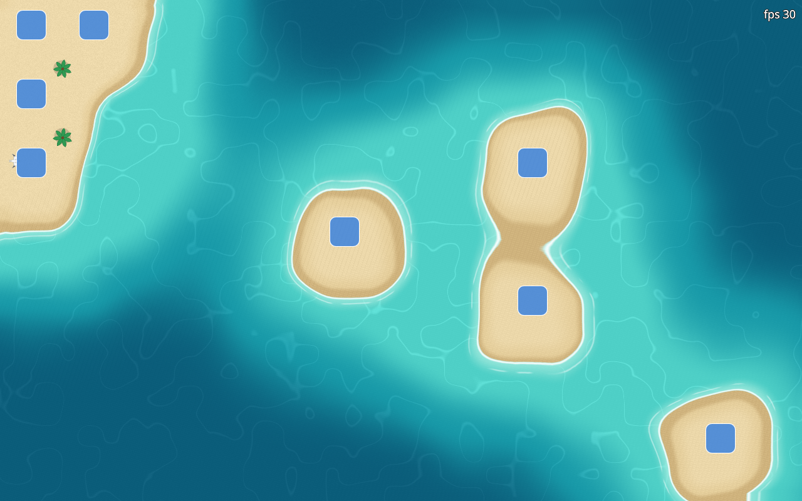

# Archipelago



Archipelago is an animated KDE Plasma 6 wallpaper that grows a living landscape
around your desktop icons. An environment engine tracks the icons and widgets
on the desktop, groups the ones that sit together and tells the active theme
when an icon is added, removed, moved or joins a group. The theme draws the
world around them.

## Themes

- **Beach**: sandy islands in a tropical sea. Islands grow around new icons,
  merge when icons sit together, change their coastline when icons move and
  sink when icons go. Palm trees grow on larger islands, a kayak crosses open
  water and seabirds fly past. Three palettes (tropical, sunset, night), an
  optional time-of-day tint and an optional permanent beach along one screen
  edge.
- **Blueprint**: the engine's view of your desktop drawn as a technical plan.
  It is the reference for writing new themes.

New themes are one directory and one registry entry; see
[docs/themes.md](docs/themes.md).

## Settings

Right-click the desktop → Desktop and Wallpaper → Wallpaper type: Archipelago.

- Theme and the theme's own settings
- Area around each icon, appear and sink delays, morph duration
- Animation on or off, land around widgets, frame rate limit, render scale
- Pause under a maximized or full-screen window, or under any window that
  covers most of the screen
- Battery saver (15 fps, 75 % render scale on battery or in power-saver mode)

## Power behaviour

The animation stops while a window covers the desktop (as configured), while
the screen is locked, and when nothing is visible. On battery or in the
power-saver profile the frame rate and render scale drop.

## Picture export

Right-click the desktop → "Save Picture Without Icon Names" saves the current
landscape to your Pictures folder with plain blocks in place of the icons, so
it can be shared without revealing file names.

## Requirements

- KDE Plasma 6.3 or later with the Folder View desktop layout (verified on
  Plasma 6.8.2)
- `qsb-qt6` (Qt Shader Tools) to compile the shaders

## Install

```sh
make install   # compile shaders and install to ~/.local/share/plasma/wallpapers
make apply     # set Archipelago as the wallpaper on every desktop
make reload    # restart plasmashell to load new QML
make restore   # switch back to the default image wallpaper
```

## More

- [docs/themes.md](docs/themes.md): writing a theme
- [docs/compatibility.md](docs/compatibility.md): Plasma versions, limits, test matrix
- [docs/upstream-request.md](docs/upstream-request.md): draft request for a
  public icon-geometry API in Plasma
- [CONTRIBUTING.md](CONTRIBUTING.md): build, test and contribute

## License

GPL-3.0-or-later. See `LICENSE`.
