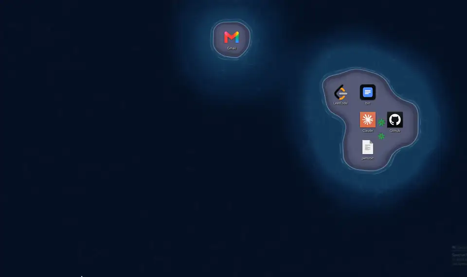

<p align="center">
  
</p>

<h1 align="center">Scapelet</h1>

<p align="center">
  A living wallpaper for KDE Plasma that grows a little world around your desktop icons.
</p>

<p align="center">
  
</p>

## What it does

Put an icon on your desktop and, a moment later, land rises around it. Put a
few icons together and their land merges into one. Drag an icon somewhere else
and the landscape follows; delete it and the land quietly disappears.

<p align="center">
  
  <br>
  <sub>On a real desktop (Beach theme, night palette): a new folder gets an island, the island sinks when the folder is deleted, gulls fly past.</sub>
</p>

Scapelet is the engine that watches your desktop. Themes decide what the world
looks like:

- **Beach**: sandy islands in a turquoise sea. Bigger islands grow palm trees, a
  kayak paddles through open water and seabirds fly past now and then. Pick a
  tropical, sunset or night palette, let the light follow the time of day, or
  add a permanent beach along one edge of the screen.
- **Meadow**: your icons rest on puffy clouds that float over wind-swept grass
  and cast soft shadows on it. Butterflies drift past. Spring, summer and dusk
  palettes.
- **Cosmos**: a twinkling night sky. A glowing nebula gathers around every
  icon, grouped icons are joined into constellations, and a shooting star
  crosses now and then. Violet, teal and ember palettes.
- **Blueprint**: your desktop drawn as a technical plan, with contour lines
  around every group of icons.

More themes can be added without touching the engine. A city is on the list of
ideas.

## Install

You need KDE Plasma 6.3 or newer and the default "Folder View" desktop (the one
that shows icons). To build it, you also need `make` and Qt Shader Tools:

```sh
sudo dnf install make qt6-qtshadertools     # Fedora
```

Then, from this folder:

```sh
make install   # install for your user
make apply     # use Scapelet as the wallpaper on every desktop
```

To go back to a normal picture wallpaper at any time, run `make restore`.

## Make it yours

Right-click the desktop, choose **Desktop and Wallpaper**, and set
**Wallpaper type** to **Scapelet**. There you can:

- switch themes, and change each theme's own options;
- make the land around each icon bigger or smaller;
- choose how quickly land appears and disappears;
- turn the palm trees, kayak and seabirds on or off one by one;
- choose whether land also grows around desktop widgets.

## Kind to your battery

Scapelet stops animating when you cannot see it: when a window covers the
desktop, when the screen is locked, or when the display is off. On battery or
in power-saver mode it runs at a lower frame rate and resolution. You can
change all of this in the settings.

## Share your landscape

Right-click the desktop and choose **Save Picture Without Icon Names**. The
picture goes to your Pictures folder, with plain blocks where your icons are, so
nothing about your files is shown.

## Something not working?

- **Only water, no land:** Scapelet needs the "Folder View" desktop layout. If
  you use it and still see no land, run `make debug-on`, then
  `journalctl --user -u plasma-plasmashell.service -f | grep scapelet:` and
  open an issue with what it prints.
- **Changes do not show up after updating:** run `make reload`.

More detail is in [docs/compatibility.md](docs/compatibility.md).

## For developers

- [CONTRIBUTING.md](CONTRIBUTING.md): building, testing and the make targets
- [docs/themes.md](docs/themes.md): how to write a theme
- [docs/upstream-request.md](docs/upstream-request.md): a draft request for a
  public icon-position API in Plasma

## License

Scapelet is free software under the GPL-3.0-or-later license. See
[LICENSE](LICENSE).
